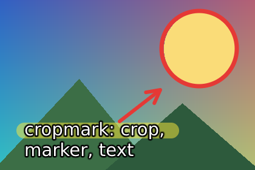
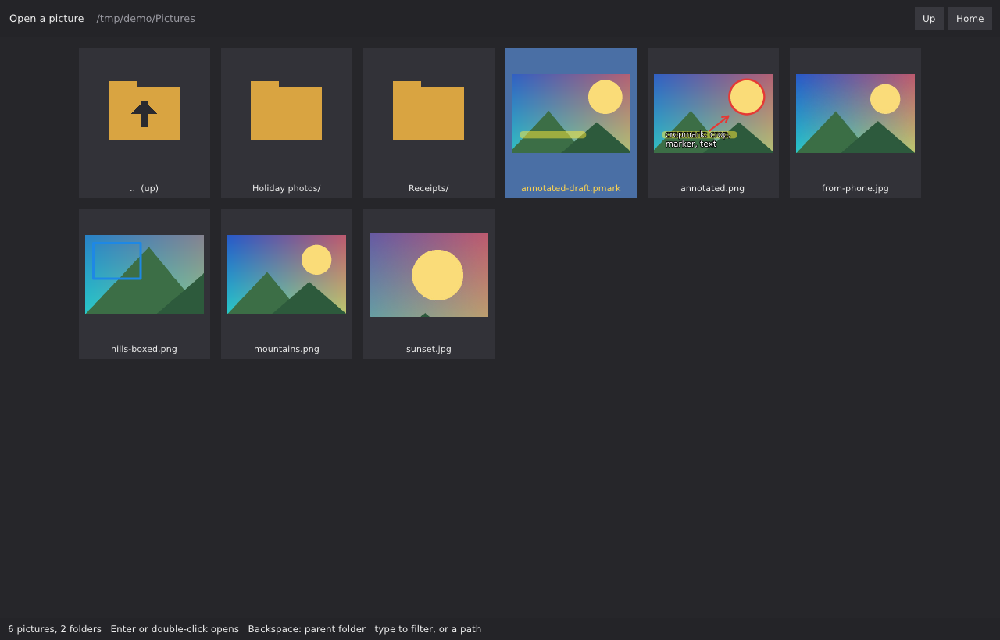
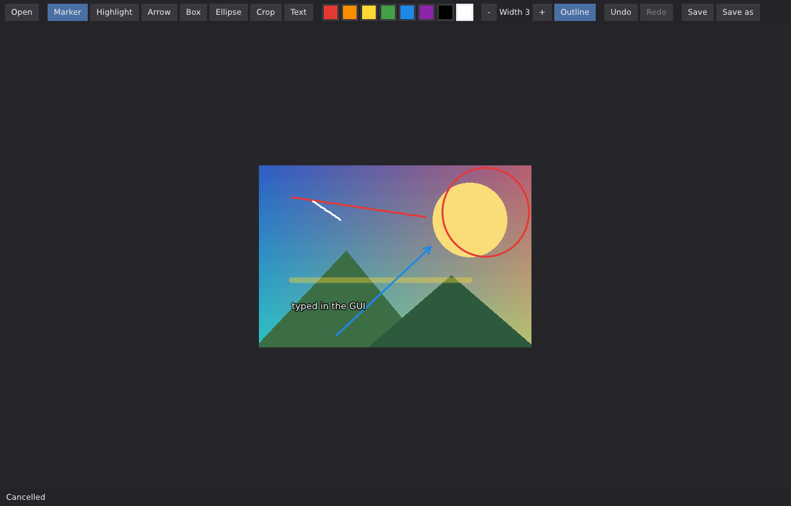

# cropmark

cropmark marks up photos, crops, and adds text. It is a small C11 program
(formerly `pmark`) with one command, `cropmark`, that works two ways:

- **In a window.** Run `cropmark` on its own to browse the pictures in the
  current folder and pick one, or `cropmark photo.jpg` to open the editor on
  that photo straight away.
- **From the command line**, for scripted and batch edits:
  `cropmark photo.jpg --crop ... -o out.jpg` applies the edits without
  opening a window.



## Features

- **Input:** JPEG and PNG. Phone photos stored sideways are rotated upright
  automatically using their EXIF orientation.
- **Edits:** crop, freehand marker, highlighter, arrow, box, ellipse, and
  text with an optional outline. Any colour can be translucent, and a
  highlighter stroke that crosses itself does not darken where it overlaps.
- **Undo and redo** for every edit, including crops: undoing a crop brings
  the cropped-away pixels back.
- **Picture picker:** thumbnails of every photo in a folder, with folder
  navigation and type-to-filter.
- **Safe saving:** files are written atomically, so a failed save never
  leaves a half-written file. cropmark never silently replaces the photo you
  opened.
- **Colour profiles are kept**, so photos from phones (often Display P3)
  don't come out washed out. Other EXIF data, including GPS location, is
  dropped.
- **Sessions:** a `.pmark` file records the photo and every edit, so you can
  reopen an edit later and keep working on it.
- **Hardened input:** oversized images are rejected from their header alone
  before any pixels are decoded, and every file parser is fuzz-tested.

## Building

You need a C11 compiler, `make` and SDL2 (for the window).

| Platform | Install the dependencies |
|---|---|
| Debian / Ubuntu | `sudo apt install build-essential libsdl2-dev` |
| Fedora | `sudo dnf install gcc make SDL2-devel` |
| Arch | `sudo pacman -S base-devel sdl2` |
| macOS (Homebrew) | `xcode-select --install && brew install sdl2 pkg-config` |

```sh
make            # builds build/cropmark
make install    # copies it to ~/.local/bin (or: sudo make install PREFIX=/usr/local)
```

After `make install`, `cropmark` runs from any folder, provided
`~/.local/bin` is on your `PATH` (it is by default on most Linux desktops;
`make install` tells you if it isn't). `make uninstall` removes it.

The image codecs and font rasteriser (stb) are vendored in `third_party/`,
so nothing else needs installing. On a machine without SDL2, `make headless`
builds `build/cropmark-headless`, which has the command-line mode only.

## Quick start

Go to a folder of photos and run `cropmark`:

```sh
cd ~/Pictures
cropmark
```

A grid of the pictures there opens. Double-click one (or select it and
press `Enter`) to edit it. To skip the picker, name the photo:

```sh
cropmark photo.jpg
```

Press `Ctrl+S` to save. The result goes to `photo-marked.png`, alongside a
`photo-marked.pmark` session you can reopen later. `Ctrl+O` goes back to
the picker to open another picture.

Or annotate a photo without opening a window:

```sh
cropmark photo.jpg \
    --crop 100,50,1600,1200 \
    --color ffeb3b80 --width 40 --stroke "200,900 1200,900" \
    --color e53935 --width 10 --arrow 300,200,520,400 \
    --color ffffff --size 64 --outline 4 --text 220,860 "Look here" \
    -o marked.jpg
```

## How cropmark decides what to do

| Command | What happens |
|---|---|
| `cropmark` | picture picker in the current folder |
| `cropmark FOLDER` | picture picker in `FOLDER` |
| `cropmark PHOTO [OUTPUT]` | editor window on `PHOTO` (a `.jpg`/`.png`, or a `.pmark` session) |
| `cropmark PHOTO EDITS... -o OUTPUT` | command-line mode: apply the edits, no window |

Any option other than the window's own (`--quality N`, `--no-session`)
selects command-line mode. `cropmark --help` prints the full reference.

## Command-line reference

```
cropmark INPUT [edits and settings...] [-o OUTPUT] [--save-session FILE.pmark]
```

`INPUT` is a `.jpg`/`.jpeg`/`.png` photo or a `.pmark` session. Arguments
run **left to right**, like a small script. Settings apply to the edits that
come after them, and each edit's coordinates are pixels in the image *as it
is at that point*, so after a `--crop`, `0,0` is the crop's top-left corner.

**Edits**

| Flag | Draws |
|---|---|
| `--crop X,Y,W,H` | keeps only this rectangle |
| `--stroke "X,Y X,Y ..."` | a freehand line through the points (one point draws a dot) |
| `--arrow X0,Y0,X1,Y1` | an arrow pointing at `X1,Y1` |
| `--rect X,Y,W,H` | a rectangle outline |
| `--ellipse X,Y,W,H` | an ellipse outline inside the rectangle |
| `--text X,Y "STRING"` | text whose top-left corner is at `X,Y` (`\n` starts a new line) |

**Settings**

| Flag | Default | Meaning |
|---|---|---|
| `--color RRGGBB[AA]` | `e53935` (red) | colour for lines and text; an alpha below `ff` makes it translucent |
| `--width PX` | `8` | line width |
| `--size PX` | `48` | text height |
| `--outline PX` | `0` (off) | width of the outline around text |
| `--outline-color HEX` | `000000` | outline colour |
| `--font FILE.ttf` | see [Fonts](#fonts) | TrueType font for text |

**Output**

| Flag | Meaning |
|---|---|
| `-o FILE` | write `.png`, `.jpg` or `.jpeg` (format chosen by the extension) |
| `--quality N` | JPEG quality, 1 to 100 (default 92) |
| `--no-clobber` | fail rather than replace an existing file |
| `--force` | allow `-o` to replace the input photo (refused otherwise) |
| `--strip-icc` | don't embed the colour profile in the output |
| `--save-session FILE` | also write a `.pmark` session |
| `--lenient` | open a session even if its photo changed or its font is missing |
| `--info` | print the final image size, e.g. `1600x1200` |

Exit status is 0 on success, 1 if an edit or file operation failed, and 2
for a usage error. Run `cropmark --help` for the same reference.

**More examples**

```sh
# A translucent yellow highlight and a green box, saved as PNG
cropmark scan.png --color fdd83580 --width 30 --stroke "120,400 900,400" \
    --color 43a047 --width 6 --rect 100,360,820,80 -o scan-marked.png

# Several lines of text with a contrasting outline
cropmark photo.jpg --color ffffff --size 56 --outline 3 \
    --text 40,40 "Before the repair\nNorth wall, 3 May" -o labelled.jpg

# Just crop
cropmark photo.jpg --crop 0,0,1200,800 -o cropped.jpg
```

## The picture picker

```sh
cropmark [FOLDER]
```



The picker shows the folders and pictures (`.jpg`, `.jpeg`, `.png` and
`.pmark` sessions) in a folder, folders first. Thumbnails load in the
background, so large folders of big photos stay responsive. A session's
thumbnail shows its edits, and its name is drawn in yellow. Hidden files
are not listed.

| Key / mouse | Action |
|---|---|
| click | select |
| double-click, `Enter` | open the picture, or go into the folder |
| arrow keys, `PgUp` / `PgDn`, `Home` / `End` | move the selection |
| `Backspace`, `Alt+Up`, the **Up** button | parent folder |
| the **Home** button | your home folder |
| typing | show only names containing the text (any case) |
| typing a path containing `/`, or starting with `~`, then `Enter` | open that folder or picture |
| `Esc` | clear the filter; with no filter, close the picker |

Closing the picker with `Esc` returns to the picture you were editing, or
quits if none is open yet.

## The editor

```sh
cropmark PHOTO [OUTPUT] [--quality N] [--no-session]
```



The toolbar along the top holds Open, the tools, eight colours, size
controls, an outline toggle, undo, redo, Save and Save as. Everything also
has a keyboard shortcut:

| Key / mouse | Action |
|---|---|
| `M` | marker: drag to draw |
| `H` | highlighter: a wide translucent marker |
| `A` / `B` / `E` | arrow / box / ellipse: drag from corner to corner (or tail to tip) |
| `C` | crop: drag a box, then `Enter` to apply or `Esc` to cancel |
| `T` | text: click to place, type, drag the box to move it, `Enter` to finish (`Shift+Enter` for a new line) |
| `O` | text outline on or off |
| `1` to `8` | red, orange, yellow, green, blue, purple, black, white |
| `[` / `]` | smaller / larger line or text |
| mouse wheel | zoom around the cursor |
| middle-drag, or `Space` + drag | pan |
| `0` | fit the photo to the window |
| `Ctrl+Z` / `Ctrl+Y` (or `Ctrl+Shift+Z`) | undo / redo |
| `Ctrl+S` | save |
| `Ctrl+Shift+S` | save as |
| `Ctrl+O` | back to the picture picker, in the photo's folder |
| `Esc` | cancel whatever is in progress |

The status bar along the bottom shows the file, image size, zoom and where
the output will be saved, along with messages and prompts.

### Saving in the editor

- **Where it saves.** `OUTPUT` if you gave one, otherwise `photo-marked.png`
  next to the photo. For a `.pmark` session, the default is the session's
  name with `.png`.
- **Asking first.** The first time you save over a file that already exists,
  the status bar asks for confirmation: `Enter` replaces the file, `Esc`
  cancels. Saving over the original photo gets a stronger warning. Once the
  editor has written a file, later saves to it don't ask again.
- **Save as** changes the file name only. The prompt shows the current name
  without its extension, and the extension (`.png` or `.jpg`) stays the
  same. If you type an extension anyway, cropmark replaces it rather than
  doubling it. To save in a different format, start the editor with an
  `OUTPUT` of that type, e.g. `cropmark photo.jpg out.jpg`.
- **Sessions.** Every save also writes `NAME.pmark` next to the image
  (unless you pass `--no-session`).
- **Closing or opening another picture.** If you close the window or press
  `Ctrl+O` with unsaved changes, the status bar warns you; do it again to
  go ahead. From the picker, `Esc` takes you back to the unsaved edit:
  nothing is lost until you actually open another picture.

## Sessions

A session is a small text file listing the photo and every edit:

```
pmark-session 1
base "photo.jpg" 9b2928b9eaa7cf92
crop 30 20 420 280
stroke ffeb3b80 26 2 40 215 250 215
text ffffffff 34 40 196 3 000000ff "/usr/share/fonts/truetype/dejavu/DejaVuSans.ttf" "Look\nhere"
```

Open one in the editor or on the command line to continue where you left
off. Undo keeps
working through the reopened edits.

```sh
cropmark photo.jpg --crop 0,0,800,600 -o out.png --save-session edit.pmark
cropmark edit.pmark --arrow 50,50,200,200 -o out-v2.png    # continue
cropmark edit.pmark                                        # or in the editor
```

- The photo is stored **relative to the session file** when it's in the same
  folder (or below), so you can move the folder as a unit.
- The session remembers a fingerprint of the photo. If the photo has
  changed since, cropmark refuses to open the session rather than silently
  drawing on the wrong image. `--lenient` (or the editor, which warns)
  opens it anyway.
- Fonts are recorded by path. On another computer, use `--lenient` to fall
  back to the default font; text may then be laid out slightly differently.

## How files are handled

- **Atomic saves.** The output is written to a temporary file in the same
  folder, synced to disk, then renamed into place. If anything goes wrong,
  you keep the previous file, and the temporary file is removed.
- **The original is protected.** The command line refuses `-o` pointing at
  the input photo (even through a hard link) unless you pass `--force`. The
  editor asks first.
- **Metadata:**

  | | What cropmark does |
  |---|---|
  | Colour profile (ICC) | kept, unless `--strip-icc` |
  | Orientation | applied to the pixels, then removed |
  | Other EXIF (camera, date, GPS) | removed |

- **Formats.** PNG output from an opaque photo is saved without an alpha
  channel, which makes it smaller. JPEG has no transparency, so transparent
  areas become white.
- **Limits.** Images up to 32768 pixels per side and 128 megapixels. Bigger
  or malformed files are refused with an error rather than exhausting
  memory.

## Fonts

Text needs a TrueType font. cropmark looks, in order, at `--font FILE.ttf` on
the command line, the `PMARK_FONT` environment variable, and common system
locations (DejaVu Sans, Liberation Sans or Noto Sans on Linux, Arial on
macOS and Windows). If none is found, text is unavailable but everything
else works.

```sh
export PMARK_FONT=/path/to/MyFont.ttf
```

## Testing

```sh
make test           # unit tests, command-line end-to-end tests, golden images,
                    # and scripted editor and picker sessions (no display needed)
make asan           # all of the above under AddressSanitizer + UBSan
make test-headless  # the tests that need no SDL2, against cropmark-headless
make fuzz-smoke     # mutation-fuzz the image, EXIF, ICC and session parsers
```

`make golden-update` regenerates the reference images in `tests/golden/`
after an intended change to rendering; review the image diff before
committing. With clang, `make fuzz-libfuzzer` runs coverage-guided fuzzing.

## Project layout

```
include/pmark.h     public API of the editing core
src/                the core: images, drawing, text, documents, sessions, files
cli/main.c          cropmark's entry point: picks the window or command-line mode
cli/batch.c         command-line mode
gui/gui.c           the window and the editor (SDL2)
gui/picker.c        the picture picker
tests/              unit, end-to-end, golden-image, GUI and fuzz tests, fixtures
third_party/        vendored stb headers
docs/               ARCHITECTURE.md and README images
```

The core is a library (`build/libpmark.a`) with no dependency on SDL, so
another front end can be built on it. The core keeps its original `pm_`
prefix, and session files keep the `.pmark` extension and the `PMARK_FONT`
variable, so existing sessions and settings keep working. [docs/ARCHITECTURE.md](docs/ARCHITECTURE.md)
covers the design: data model, rendering, the session format, input limits,
the persistence rules and the roadmap.

## Known limitations

- Committed edits can't be selected or moved; use undo instead.
- The editor's Save As takes a typed name, not a file dialog, and keeps the
  output format.
- The picker uses POSIX folder listing, so the window builds on Linux and
  macOS; Windows is not supported yet.
- Very large images must fit in one GPU texture to be shown in the editor
  (commonly 8192 or 16384 pixels per side). The command line has no such
  limit.
- Text is laid out left to right with simple kerning: no right-to-left
  scripts, ligatures or colour emoji.

## License
This project is licensed under Creative Commons Zero license.
